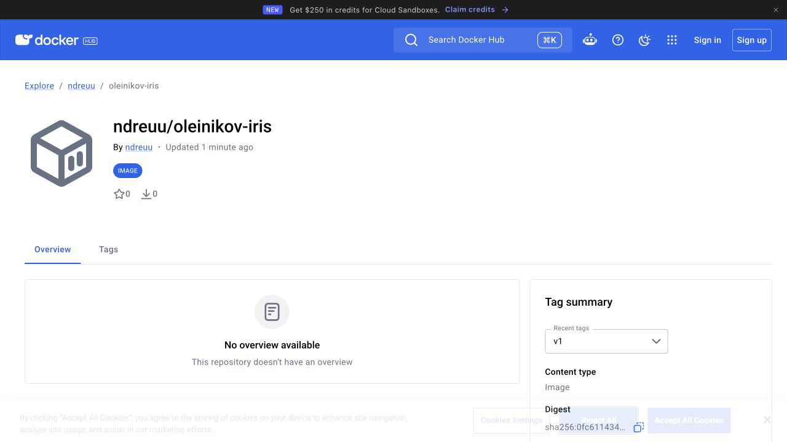

# Лабораторная работа №1. Iris: от модели до Kubernetes

**Автор:** Олейников, префикс ресурсов `oleinikov-iris`, Docker Hub `ndreuu`.

**Проверено:** 22.11.2026, 13:17–13:20 (Europe/Moscow).

Ниже приведены выполненные команды и фактический stdout/stderr. Консольные цвета в README убраны; исходный вывод сохранён в `evidence/commands.json`. Это повторная проверка уже работающего сервиса: `CACHED`, `Layer already exists` и `unchanged` означают использование существующих образа и объектов. Успешные команды завершились с кодом `0`. Исключение — проверка отсутствия прав в `mlops-students`: ожидаемые `no` и код `1`.

## 0. Что получилось

| Требование методички | Результат и пруф |
|---|---|
| Локально работают `/health`, `/predict` | HTTP 200, `ready`, классы `0` и `2`; [раздел 3](#local-api) |
| Образ опубликован в registry | `docker.io/ndreuu/oleinikov-iris:v1`, успешный push, публичный репозиторий; [раздел 6](#registry) |
| Свои ConfigMap, Deployment и Service с уникальным префиксом | `oleinikov-iris-config`, `oleinikov-iris`, namespace `itmo-student-13`; [раздел 9](#deployment) |
| Проверка через `kubectl port-forward` и `curl` | HTTP 200, `ready`, setosa → `0`, virginica → `2`; [раздел 10](#port-forward) |

**Отличие от методички:** в ней указан `mlops-students`, а в выданном персональном архиве `itmo-student-13.zip` назначен `itmo-student-13`. Использован персональный namespace; в `mlops-students` этот доступ не разрешает создавать Deployment. Команды, подтверждающие это, — в [разделе 1](#access). Буквально пункт о размещении в `mlops-students` не выполнялся.

Формат отчёта взят за ориентир из [примера лабораторной](https://github.com/Ja1rman/mlops/tree/main/lab1). Исходники сервиса взяты из выданного `ml-service.zip`, имена ресурсов и доступ — свои.

### Где запускались команды

| Машина | Рабочий каталог | Этапы |
|---|---|---|
| Mac | `/Users/andrew/Projects/mlops/lab1/ml-service` | Python, Uvicorn, kubecm, kubectl, port-forward |
| Учебная ВМ, `ssh mlops` | `/home/oleinikov/projects/mlops/lab1/ml-service` | pass, Docker login/build/run/push |

Перед блоками команд нужно перейти в соответствующий рабочий каталог. Kubeconfig хранится на Mac вне репозитория. `curl -w` дописывает строку HTTP-статуса после JSON-ответа.

<a id="access"></a>

## 1. Доступ к кластеру: `.kube`, kubectl, kubecm

Выполнено на Mac.

```bash
kubectl version --client=true
```

```text
Client Version: v1.37.2
Kustomize Version: v5.8.1
```

Код завершения: `0`.

```bash
kubecm version
```

```text
Version: 0.36.0
GoOs: darwin
GoArch: arm64
```

Код завершения: `0`.

```bash
kubecm list
```

```text
┌────────────┬────────────────────┬─────────────────┬────────────────────┬───────────────────────────────┬────────────────────┐
│   CURRENT  │        NAME        │     CLUSTER     │        USER        │             SERVER            │      Namespace     │
╞════════════╪════════════════════╪═════════════════╪════════════════════╪═══════════════════════════════╪════════════════════╡
│      *     │   itmo-student-13  │   stud-cluster  │   itmo-student-13  │   https://37.18.117.109:6443  │   itmo-student-13  │
└────────────┴────────────────────┴─────────────────┴────────────────────┴───────────────────────────────┴────────────────────┘

Cluster check succeeded!
Kubernetes version v1.36.4
Kubernetes master is running at https://37.18.117.109:6443
(Error reporting can be ignored and does not affect usage.)
```

Код завершения: `0`.

```bash
stat -f '%Sp %N' /Users/andrew/.kube /Users/andrew/.kube/config /Users/andrew/.kube/itmo-student-13.kubeconfig
```

```text
drwx------ /Users/andrew/.kube
-rw------- /Users/andrew/.kube/config
-rw------- /Users/andrew/.kube/itmo-student-13.kubeconfig
```

Код завершения: `0`.

```bash
kubectl config current-context
```

```text
itmo-student-13
```

Код завершения: `0`.

```bash
kubectl config view --minify -o 'jsonpath={.contexts[0].context.namespace}{"\n"}'
```

```text
itmo-student-13
```

Код завершения: `0`.

Права на создание трёх типов ресурсов в назначенном namespace:

```bash
kubectl --context=itmo-student-13 -n itmo-student-13 auth can-i create deployments
```

```text
yes
```

Код завершения: `0`.

```bash
kubectl --context=itmo-student-13 -n itmo-student-13 auth can-i create services
```

```text
yes
```

Код завершения: `0`.

```bash
kubectl --context=itmo-student-13 -n itmo-student-13 auth can-i create configmaps
```

```text
yes
```

Код завершения: `0`.

Проверка namespace из общей методички (ожидаемый отказ):

```bash
kubectl --context=itmo-student-13 -n mlops-students auth can-i create deployments
```

```text
no
```

Код завершения: `1`.

Вывод: рабочие контекст и namespace — `itmo-student-13`; прав для Deployment в `mlops-students` нет. Поэтому все объекты манифеста используют выданный namespace.

<a id="python-env"></a>

## 2. Python-окружение

На Mac используется `.venv`, созданное через стандартный `venv` — это разрешённая в разделе 3.2 методички альтернатива `uv`.

```bash
.venv/bin/python --version
```

```text
Python 3.12.16
```

Код завершения: `0`.

```bash
.venv/bin/python -c 'from importlib.metadata import version; [print(f"{p}=={version(p)}") for p in ("fastapi","uvicorn","scikit-learn","joblib")]'
```

```text
fastapi==0.116.1
uvicorn==0.35.0
scikit-learn==1.7.1
joblib==1.5.1
```

Код завершения: `0`.

Версии совпадают с [requirements.txt](ml-service/requirements.txt).

<a id="local-api"></a>

## 3. Обучение и локальный Uvicorn

Выполнено на Mac. [train.py](ml-service/train.py) обучает Random Forest на Iris и сохраняет `model.joblib`. У скрипта нет собственного консольного вывода; успех подтверждают код завершения, файл модели и ответы запущенного API.

```bash
.venv/bin/python train.py
```

Вывода в stdout/stderr нет.

Код завершения: `0`.

```bash
ls -lh model.joblib
```

```text
-rw-r--r--@ 1 andrew  staff    93K Nov 22 13:17 model.joblib
```

Код завершения: `0`.

Сервер работал во время следующих `curl`. После проверки остановлен через Ctrl+C/SIGINT; ниже полный журнал запуска и остановки.

```bash
.venv/bin/uvicorn app.main:app --host 127.0.0.1 --port 8000
```

```text
INFO:     Started server process [52699]
INFO:     Waiting for application startup.
INFO:     Application startup complete.
INFO:     Uvicorn running on http://127.0.0.1:8000 (Press CTRL+C to quit)
INFO:     127.0.0.1:50206 - "GET /live HTTP/1.1" 200 OK
INFO:     127.0.0.1:50207 - "GET /health HTTP/1.1" 200 OK
INFO:     127.0.0.1:50208 - "POST /predict HTTP/1.1" 200 OK
INFO:     127.0.0.1:50209 - "POST /predict HTTP/1.1" 200 OK
INFO:     127.0.0.1:50210 - "POST /predict HTTP/1.1" 200 OK
INFO:     Shutting down
INFO:     Waiting for application shutdown.
INFO:     Application shutdown complete.
INFO:     Finished server process [52699]
```

Код завершения: `0`.

```bash
curl -fsS --max-time 15 -w '
HTTP %{http_code}
' http://127.0.0.1:8000/live
```

```text
{"status":"alive"}
HTTP 200
```

Код завершения: `0`.

```bash
curl -fsS --max-time 15 -w '
HTTP %{http_code}
' http://127.0.0.1:8000/health
```

```text
{"status":"ready","model_version":"iris-v1"}
HTTP 200
```

Код завершения: `0`.

```bash
curl -fsS --max-time 15 -w '
HTTP %{http_code}
' -X POST http://127.0.0.1:8000/predict -H 'content-type: application/json' -d '{"features":[5.1,3.5,1.4,0.2]}'
```

```text
{"class_id":0,"model_version":"iris-v1"}
HTTP 200
```

Код завершения: `0`.

```bash
curl -fsS --max-time 15 -w '
HTTP %{http_code}
' -X POST http://127.0.0.1:8000/predict -H 'content-type: application/json' -d '{"features":[7.0,3.2,4.7,1.4]}'
```

```text
{"class_id":1,"model_version":"iris-v1"}
HTTP 200
```

Код завершения: `0`.

```bash
curl -fsS --max-time 15 -w '
HTTP %{http_code}
' -X POST http://127.0.0.1:8000/predict -H 'content-type: application/json' -d '{"features":[6.3,3.3,6.0,2.5]}'
```

```text
{"class_id":2,"model_version":"iris-v1"}
HTTP 200
```

Код завершения: `0`.

Вывод: локальное обучение и API работают; `/health` → `ready`, `/predict` → `0`, `1`, `2` для setosa, versicolor и virginica.

<a id="docker-auth"></a>

## 4. `pass`, credential helper и Docker login

Выполнено на учебной ВМ через `ssh mlops`. Использован уже созданный учебный GPG-ключ; повторный `pass init` выполнен с тем же публичным fingerprint. Конфигурация Docker выведена только в части `credsStore`, без учётных данных.

```bash
docker version --format 'Client={{.Client.Version}} Server={{.Server.Version}}'
```

```text
Client=29.9.3 Server=29.9.3
```

Код завершения: `0`.

```bash
which docker-credential-pass
```

```text
/usr/local/bin/docker-credential-pass
```

Код завершения: `0`.

```bash
python3 -c 'import json,pathlib; c=json.loads((pathlib.Path.home()/".docker/config.json").read_text()); print(json.dumps({"credsStore":c.get("credsStore")}))'
```

```text
{"credsStore": "pass"}
```

Код завершения: `0`.

```bash
cat /home/oleinikov/.password-store/.gpg-id
```

```text
F2DA2108503EB840B93109E2DC0D45A1EF6B420D
```

Код завершения: `0`.

```bash
pass init F2DA2108503EB840B93109E2DC0D45A1EF6B420D
```

```text
Password store initialized for F2DA2108503EB840B93109E2DC0D45A1EF6B420D
```

Код завершения: `0`.

```bash
pass ls
```

```text
Password Store
└── docker-credential-helpers
    ├── aHR0cHM6Ly9pbmRleC5kb2NrZXIuaW8vdjEv
    │   └── ndreuu
    ├── aHR0cHM6Ly9pbmRleC5kb2NrZXIuaW8vdjEvYWNjZXNzLXRva2Vu
    │   └── ndreuu
    └── aHR0cHM6Ly9pbmRleC5kb2NrZXIuaW8vdjEvcmVmcmVzaC10b2tlbg==
        └── ndreuu
```

Код завершения: `0`.

```bash
docker-credential-pass list
```

```text
{"https://index.docker.io/v1/":"ndreuu","https://index.docker.io/v1/access-token":"ndreuu","https://index.docker.io/v1/refresh-token":"ndreuu"}
```

Код завершения: `0`.

```bash
docker login
```

```text
Authenticating with existing credentials... [Username: ndreuu]

 Info -> To login with a different account, run 'docker logout' followed by 'docker login'


Login Succeeded
```

Код завершения: `0`.

Вход `docker login` повторно использует сохранённую авторизацию аккаунта `ndreuu`; получен `Login Succeeded`. Вывод helper `list` содержит адреса registry и имя пользователя.

<a id="docker-build"></a>

## 5. Docker build и проверка контейнера

На ВМ повторно собран [Dockerfile](ml-service/Dockerfile) с временным тегом `oleinikov-iris:proof-v1`. Сборка использовала кеш, включая обучение модели; полученный image ID совпадает с опубликованным `v1`.

```bash
docker build --pull=false --progress=plain -t oleinikov-iris:proof-v1 .
```

```text
#0 building with "default" instance using docker driver

#1 [internal] load build definition from Dockerfile
#1 transferring dockerfile: 696B done
#1 DONE 0.1s

#2 [internal] load metadata for docker.io/library/python:3.12-slim
#2 ...

#3 [auth] library/python:pull token for registry-1.docker.io
#3 DONE 0.0s

#2 [internal] load metadata for docker.io/library/python:3.12-slim
#2 DONE 1.1s

#4 [internal] load .dockerignore
#4 transferring context: 2B done
#4 DONE 0.1s

#5 [builder 1/4] FROM docker.io/library/python:3.12-slim@sha256:5e2bdb1b0d542d5039cffb8181c65930093949194a65c365dfb1b0fe13a4fa5b
#5 DONE 0.0s

#6 [internal] load build context
#6 transferring context: 531B done
#6 DONE 0.1s

#7 [stage-1 4/9] COPY --from=builder /wheels /wheels
#7 CACHED

#8 [stage-1 6/9] RUN pip install --no-cache-dir --no-index --find-links=/wheels -r requirements.txt     && rm -rf /wheels
#8 CACHED

#9 [stage-1 5/9] COPY requirements.txt .
#9 CACHED

#10 [stage-1 8/9] COPY --chown=app:app train.py .
#10 CACHED

#11 [builder 2/4] WORKDIR /build
#11 CACHED

#12 [stage-1 7/9] COPY --chown=app:app app ./app
#12 CACHED

#13 [stage-1 2/9] RUN addgroup --system app && adduser --system --ingroup app --uid 10001 app
#13 CACHED

#14 [stage-1 3/9] WORKDIR /app
#14 CACHED

#15 [builder 3/4] COPY requirements.txt .
#15 CACHED

#16 [builder 4/4] RUN pip wheel --no-cache-dir --wheel-dir /wheels -r requirements.txt
#16 CACHED

#17 [stage-1 9/9] RUN python train.py
#17 CACHED

#18 exporting to image
#18 exporting layers done
#18 writing image sha256:3576c5eb3ed11a7c0a2d2451775c1bfb7cb58d43ffbfa4c095400b9196d311ae 0.0s done
#18 naming to docker.io/library/oleinikov-iris:proof-v1 0.1s done
#18 DONE 0.1s
```

Код завершения: `0`.

```bash
docker image inspect docker.io/ndreuu/oleinikov-iris:v1 --format 'Tags={{json .RepoTags}}
ID={{.Id}}
Platform={{.Os}}/{{.Architecture}}
User={{.Config.User}}'
```

```text
Tags=["oleinikov-iris:proof-v1","oleinikov-iris:v1","ndreuu/oleinikov-iris:v1"]
ID=sha256:3576c5eb3ed11a7c0a2d2451775c1bfb7cb58d43ffbfa4c095400b9196d311ae
Platform=linux/amd64
User=10001
```

Код завершения: `0`.

```bash
docker tag oleinikov-iris:proof-v1 docker.io/ndreuu/oleinikov-iris:v1
```

Вывода в stdout/stderr нет.

Код завершения: `0`.

Контейнер запущен на ВМ, порт доступен через loopback ВМ `127.0.0.1:18000`:

```bash
docker run --detach --rm --name oleinikov-iris-proof -p 127.0.0.1:18000:8000 docker.io/ndreuu/oleinikov-iris:v1
```

```text
7319b05916fcd01aca5446743ca7a55815153cdfb2295b8c8f4fbb97d46166d4
```

Код завершения: `0`.

```bash
curl -fsS --retry 10 --retry-all-errors --retry-delay 1 --max-time 15 -w '
HTTP %{http_code}
' http://127.0.0.1:18000/health
```

```text
{"status":"ready","model_version":"iris-v1"}
HTTP 200
```

Код завершения: `0`.

```bash
curl -fsS --max-time 15 -w '
HTTP %{http_code}
' -X POST http://127.0.0.1:18000/predict -H 'content-type: application/json' -d '{"features":[5.1,3.5,1.4,0.2]}'
```

```text
{"class_id":0,"model_version":"iris-v1"}
HTTP 200
```

Код завершения: `0`.

```bash
curl -fsS --max-time 15 -w '
HTTP %{http_code}
' -X POST http://127.0.0.1:18000/predict -H 'content-type: application/json' -d '{"features":[6.3,3.3,6.0,2.5]}'
```

```text
{"class_id":2,"model_version":"iris-v1"}
HTTP 200
```

Код завершения: `0`.

```bash
docker logs oleinikov-iris-proof
```

```text
INFO:     172.17.0.1:42574 - "GET /live HTTP/1.1" 200 OK
INFO:     172.17.0.1:42584 - "GET /health HTTP/1.1" 200 OK
INFO:     172.17.0.1:42588 - "POST /predict HTTP/1.1" 200 OK
INFO:     172.17.0.1:42602 - "POST /predict HTTP/1.1" 200 OK
INFO:     Started server process [1]
INFO:     Waiting for application startup.
INFO:     Application startup complete.
INFO:     Uvicorn running on http://0.0.0.0:8000 (Press CTRL+C to quit)
```

Код завершения: `0`.

```bash
docker stop oleinikov-iris-proof
```

```text
oleinikov-iris-proof
```

Код завершения: `0`.

Контейнер ответил HTTP 200 с ожидаемыми классами; после проверки остановлен и автоматически удалён (`--rm`).

<a id="registry"></a>

## 6. Docker Hub: образ опубликован

Push выполнен на ВМ. Повторная отправка того же образа завершилась успешно:

```bash
docker push docker.io/ndreuu/oleinikov-iris:v1
```

```text
The push refers to repository [docker.io/ndreuu/oleinikov-iris]
0aa1e843fb2b: Preparing
93ac36d5a89b: Preparing
4df771ead53d: Preparing
d1982e544bd1: Preparing
e81b40755204: Preparing
8db54932ffaa: Preparing
5f6f6c2f50ed: Preparing
6a9352455443: Preparing
340931a1d986: Preparing
96a69f98ae07: Preparing
3dc3efdf0110: Preparing
dd57f90311a2: Preparing
8db54932ffaa: Waiting
5f6f6c2f50ed: Waiting
6a9352455443: Waiting
340931a1d986: Waiting
96a69f98ae07: Waiting
3dc3efdf0110: Waiting
dd57f90311a2: Waiting
e81b40755204: Layer already exists
d1982e544bd1: Layer already exists
0aa1e843fb2b: Layer already exists
93ac36d5a89b: Layer already exists
4df771ead53d: Layer already exists
8db54932ffaa: Layer already exists
5f6f6c2f50ed: Layer already exists
6a9352455443: Layer already exists
340931a1d986: Layer already exists
96a69f98ae07: Layer already exists
3dc3efdf0110: Layer already exists
dd57f90311a2: Layer already exists
v1: digest: sha256:0fc611434bda688cb9c68877e84f52b469add3a953e9b3546aaf6aeaae2cab7b size: 2828
```

Код завершения: `0`.

```bash
docker image inspect docker.io/ndreuu/oleinikov-iris:v1 --format '{{json .RepoDigests}}'
```

```text
["ndreuu/oleinikov-iris@sha256:0fc611434bda688cb9c68877e84f52b469add3a953e9b3546aaf6aeaae2cab7b"]
```

Код завершения: `0`.

Публичная доступность проверена на Mac через API Docker Hub без авторизации:

```bash
.venv/bin/python -c 'import json,urllib.request; d=json.load(urllib.request.urlopen("https://hub.docker.com/v2/repositories/ndreuu/oleinikov-iris/", timeout=20)); print(json.dumps({k:d[k] for k in ("namespace","name","is_private")}, indent=2))'
```

```text
{
  "namespace": "ndreuu",
  "name": "oleinikov-iris",
  "is_private": false
}
```

Код завершения: `0`.

Репозиторий: [ndreuu/oleinikov-iris](https://hub.docker.com/r/ndreuu/oleinikov-iris), [тег v1](https://hub.docker.com/r/ndreuu/oleinikov-iris/tags?name=v1).



<a id="manifest"></a>

## 7. Исправленный Kubernetes-манифест

Итоговый файл: [ml-service/k8s/app.yaml](ml-service/k8s/app.yaml).

| Проверяемое поле | Значение в манифесте |
|---|---|
| Уникальные имена | ConfigMap `oleinikov-iris-config`, Deployment и Service `oleinikov-iris` |
| Namespace всех объектов | `itmo-student-13` |
| Собственный образ | `docker.io/ndreuu/oleinikov-iris:v1` |
| ConfigMap → Deployment | `envFrom.configMapRef.name: oleinikov-iris-config` |
| Переменные модели | `MODEL_VERSION=iris-v1`, `MODEL_PATH=/app/model.joblib` |
| Labels и selectors | `name=iris-api`, `instance=oleinikov-iris` у Deployment, пода и Service |
| Порты | Service `80` → именованный порт `http` → контейнер `8000` |
| Probes | readiness `/health`, liveness `/live`, порт `http` |
| Ресурсы | requests `100m / 128Mi`, limits `500m / 512Mi` |
| Тип Service | `ClusterIP` |

Фактически прочитанный манифест:

<details>
<summary>Команда cat и полный вывод app.yaml</summary>

```bash
cat k8s/app.yaml
```

```text
apiVersion: v1
kind: ConfigMap
metadata:
  name: oleinikov-iris-config
  namespace: itmo-student-13
  labels:
    app.kubernetes.io/name: iris-api
    app.kubernetes.io/instance: oleinikov-iris
data:
  MODEL_VERSION: iris-v1
  MODEL_PATH: /app/model.joblib
---
apiVersion: apps/v1
kind: Deployment
metadata:
  name: oleinikov-iris
  namespace: itmo-student-13
  labels:
    app.kubernetes.io/name: iris-api
    app.kubernetes.io/instance: oleinikov-iris
spec:
  replicas: 1
  strategy:
    type: RollingUpdate
    rollingUpdate:
      maxUnavailable: 0
      maxSurge: 1
  selector:
    matchLabels:
      app.kubernetes.io/name: iris-api
      app.kubernetes.io/instance: oleinikov-iris
  template:
    metadata:
      labels:
        app.kubernetes.io/name: iris-api
        app.kubernetes.io/instance: oleinikov-iris
    spec:
      securityContext:
        runAsNonRoot: true
        runAsUser: 10001
        seccompProfile:
          type: RuntimeDefault
      containers:
        - name: api
          image: docker.io/ndreuu/oleinikov-iris:v1
          imagePullPolicy: IfNotPresent
          envFrom:
            - configMapRef:
                name: oleinikov-iris-config
          ports:
            - name: http
              containerPort: 8000
          readinessProbe:
            httpGet:
              path: /health
              port: http
            initialDelaySeconds: 5
            periodSeconds: 5
          livenessProbe:
            httpGet:
              path: /live
              port: http
            initialDelaySeconds: 15
            periodSeconds: 10
          resources:
            requests:
              cpu: 100m
              memory: 128Mi
            limits:
              cpu: 500m
              memory: 512Mi
          securityContext:
            allowPrivilegeEscalation: false
            capabilities:
              drop: ["ALL"]
            readOnlyRootFilesystem: true
---
apiVersion: v1
kind: Service
metadata:
  name: oleinikov-iris
  namespace: itmo-student-13
  labels:
    app.kubernetes.io/name: iris-api
    app.kubernetes.io/instance: oleinikov-iris
spec:
  type: ClusterIP
  selector:
    app.kubernetes.io/name: iris-api
    app.kubernetes.io/instance: oleinikov-iris
  ports:
    - name: http
      port: 80
      targetPort: http
```

Код завершения: `0`.

</details>

<a id="dry-run"></a>

## 8. Client и server dry-run

Выполнено на Mac в контексте `itmo-student-13`. Обе проверки прошли без ошибок:

```bash
kubectl --context=itmo-student-13 -n itmo-student-13 apply --dry-run=client -f k8s/app.yaml
```

```text
configmap/oleinikov-iris-config unchanged (dry run)
deployment.apps/oleinikov-iris unchanged (dry run)
service/oleinikov-iris unchanged (dry run)
```

Код завершения: `0`.

```bash
kubectl --context=itmo-student-13 -n itmo-student-13 apply --dry-run=server -f k8s/app.yaml
```

```text
configmap/oleinikov-iris-config unchanged (server dry run)
deployment.apps/oleinikov-iris unchanged (server dry run)
service/oleinikov-iris unchanged (server dry run)
```

Код завершения: `0`.

<a id="deployment"></a>

## 9. Apply и созданные объекты

Повторный `apply` подтвердил, что работающие объекты соответствуют манифесту:

```bash
kubectl --context=itmo-student-13 -n itmo-student-13 apply -f k8s/app.yaml
```

```text
configmap/oleinikov-iris-config unchanged
deployment.apps/oleinikov-iris unchanged
service/oleinikov-iris unchanged
```

Код завершения: `0`.

```bash
kubectl --context=itmo-student-13 -n itmo-student-13 rollout status deploy/oleinikov-iris --timeout=60s
```

```text
deployment "oleinikov-iris" successfully rolled out
```

Код завершения: `0`.

```bash
kubectl --context=itmo-student-13 -n itmo-student-13 get cm,deploy,pods,svc -l app.kubernetes.io/instance=oleinikov-iris
```

```text
NAME                              DATA   AGE
configmap/oleinikov-iris-config   2      33m

NAME                             READY   UP-TO-DATE   AVAILABLE   AGE
deployment.apps/oleinikov-iris   1/1     1            1           33m

NAME                                 READY   STATUS    RESTARTS   AGE
pod/oleinikov-iris-f5658d7b8-t84vc   1/1     Running   0          33m

NAME                     TYPE        CLUSTER-IP       EXTERNAL-IP   PORT(S)   AGE
service/oleinikov-iris   ClusterIP   10.101.103.123   <none>        80/TCP    33m
```

Код завершения: `0`.

```bash
kubectl --context=itmo-student-13 -n itmo-student-13 get cm oleinikov-iris-config -o 'jsonpath={.data}{"\n"}'
```

```text
{"MODEL_PATH":"/app/model.joblib","MODEL_VERSION":"iris-v1"}
```

Код завершения: `0`.

```bash
kubectl --context=itmo-student-13 -n itmo-student-13 get endpointslices -l kubernetes.io/service-name=oleinikov-iris
```

```text
NAME                   ADDRESSTYPE   PORTS   ENDPOINTS   AGE
oleinikov-iris-42szt   IPv4          8000    10.1.0.58   33m
```

Код завершения: `0`.

Вывод: все три объекта с личным префиксом существуют в `itmo-student-13`, Deployment доступен `1/1`, под `Running`, перезапусков `0`, Service имеет endpoint.

<a id="port-forward"></a>

## 10. Port-forward, curl и совпадение digest

Выполнено на Mac. Локальный Uvicorn к этому моменту остановлен; порт `8000` используется только для проброса Service. `port-forward` работал одновременно с приведёнными ниже `curl`; после них остановлен через Ctrl+C/SIGINT.

```bash
kubectl --context=itmo-student-13 -n itmo-student-13 port-forward svc/oleinikov-iris --address=127.0.0.1 8000:80
```

```text
Forwarding from 127.0.0.1:8000 -> 8000
Handling connection for 8000
Handling connection for 8000
Handling connection for 8000
Handling connection for 8000
Handling connection for 8000
Handling connection for 8000
```

Код завершения: `0`.

```bash
curl -fsS --max-time 15 -w '
HTTP %{http_code}
' http://127.0.0.1:8000/live
```

```text
{"status":"alive"}
HTTP 200
```

Код завершения: `0`.

```bash
curl -fsS --max-time 15 -w '
HTTP %{http_code}
' http://127.0.0.1:8000/health
```

```text
{"status":"ready","model_version":"iris-v1"}
HTTP 200
```

Код завершения: `0`.

```bash
curl -fsS --max-time 15 -w '
HTTP %{http_code}
' -X POST http://127.0.0.1:8000/predict -H 'content-type: application/json' -d '{"features":[5.1,3.5,1.4,0.2]}'
```

```text
{"class_id":0,"model_version":"iris-v1"}
HTTP 200
```

Код завершения: `0`.

```bash
curl -fsS --max-time 15 -w '
HTTP %{http_code}
' -X POST http://127.0.0.1:8000/predict -H 'content-type: application/json' -d '{"features":[7.0,3.2,4.7,1.4]}'
```

```text
{"class_id":1,"model_version":"iris-v1"}
HTTP 200
```

Код завершения: `0`.

```bash
curl -fsS --max-time 15 -w '
HTTP %{http_code}
' -X POST http://127.0.0.1:8000/predict -H 'content-type: application/json' -d '{"features":[6.3,3.3,6.0,2.5]}'
```

```text
{"class_id":2,"model_version":"iris-v1"}
HTTP 200
```

Код завершения: `0`.

Образ, фактически запущенный в поде:

```bash
kubectl --context=itmo-student-13 -n itmo-student-13 get pods -l app.kubernetes.io/instance=oleinikov-iris -o 'jsonpath={range .items[*]}{.metadata.name}{"\n"}{.spec.containers[0].image}{"\n"}{.status.containerStatuses[0].imageID}{"\n"}{end}'
```

```text
oleinikov-iris-f5658d7b8-t84vc
docker.io/ndreuu/oleinikov-iris:v1
docker.io/ndreuu/oleinikov-iris@sha256:0fc611434bda688cb9c68877e84f52b469add3a953e9b3546aaf6aeaae2cab7b
```

Код завершения: `0`.

Digest пода совпадает с digest из успешного `docker push` в [разделе 6](#registry):

```text
sha256:0fc611434bda688cb9c68877e84f52b469add3a953e9b3546aaf6aeaae2cab7b
```

Вывод: запросы прошли через Kubernetes Service, модель готова; setosa → `0`, virginica → `2`. Дополнительно проверены `/live` и versicolor → `1`.

## 11. Чеклист сдачи с пруфами

- [x] `train.py` + локальный `uvicorn` работают — [команды, журнал и HTTP 200](#local-api).
- [x] Образ собран и запушен: `docker.io/ndreuu/oleinikov-iris:v1` — [build](#docker-build), [push, digest и публичность](#registry).
- [x] `pass` инициализирован, `docker login` успешен — [Password store initialized и Login Succeeded](#docker-auth).
- [x] Манифест с уникальными именами, без ошибок шаблона — [манифест и согласование полей](#manifest), [dry-run](#dry-run).
- [x] `kubectl apply --dry-run=server` без ошибок — [три объекта и код 0](#dry-run).
- [x] Объекты созданы в назначенном `itmo-student-13` — [ConfigMap, Deployment, Pod, Service](#deployment). Отличие от `mlops-students` обосновано [персональным контекстом и RBAC](#access).
- [x] Через `port-forward`: `/health` → `ready`, setosa → `0`, virginica → `2` — [команды curl и фактические ответы](#port-forward).

## 12. Файлы для проверки

- [Исходники API](ml-service/app/main.py), [обучение](ml-service/train.py), [Dockerfile](ml-service/Dockerfile), [манифест](ml-service/k8s/app.yaml).
- [macos.txt](evidence/macos.txt) — полные выводы итоговых команд на Mac.
- [vm.txt](evidence/vm.txt) — полные выводы итоговых команд на ВМ, включая build, login, push и Docker manifest.
- [commands.json](evidence/commands.json) — те же команды с временем UTC, рабочим каталогом и кодом завершения; журналы фоновых процессов включают остановку.
- [verification.json](verification.json) — структурированные результаты API и digest.
- [RUNBOOK.md](RUNBOOK.md) — инструкция по повторному запуску.

Это пруфы состояния на время проверки. После неё локальный Uvicorn, временный Docker-контейнер и port-forward остановлены; Deployment остаётся в Kubernetes.
